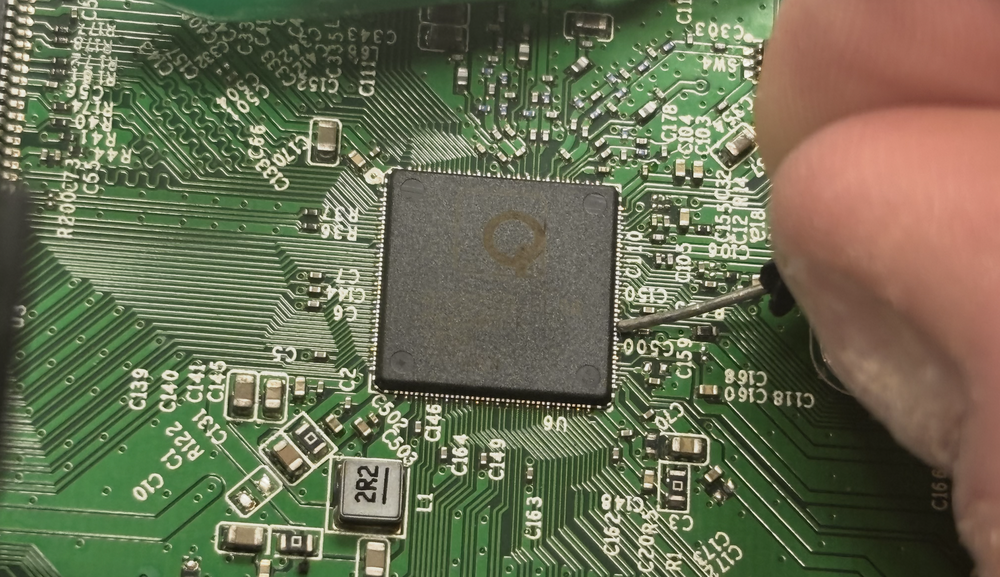
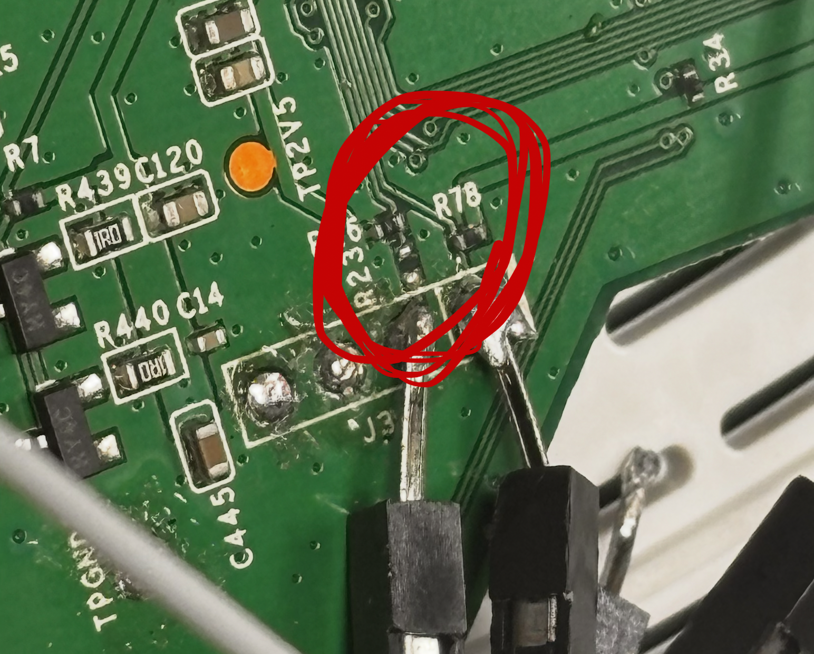
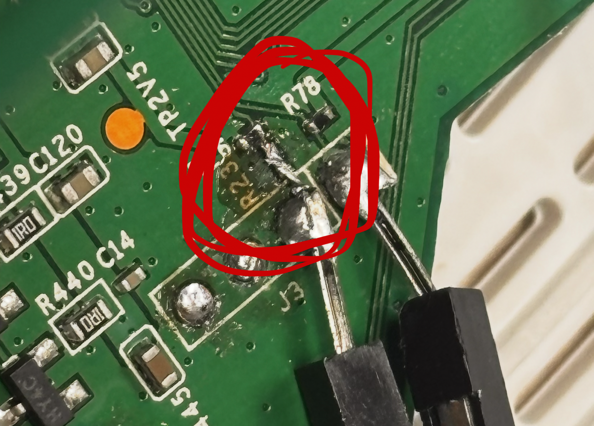

# TL-WR841N(EU) router

## Flash memory

### Reading

It is a `W25Q32FV`, so it would be trivial to read it's contents with this command:  
`flashrom -p ch347_spi -c W25Q32FV -r flash.bin`  
But if you try it, it will not work, because the CPU gets power and drives the bus. 

### Keeping CPU in reset

There is no testpin for RST in the board, but you can access the pins of the CPU.  
I tried to find a datasheet so I can locate the reset pin, but I didn't find one.  
Then I randomly tried grounding pins, and found a working one out of luck: 

### Analyzing

The `binwalk -e` command will identify and extract everything for you.  
It contains both the firmware and the settings, and plaintext passwords in settings...  
Disassembling the `U-boot` image reveals that the key to stop booting is `tpl`

### Patching

I tried to change the `bootargs` in the U-boot image with a hex editor.  
Luckily, `init=/bin/sh` is shorter than `init=/sbin/init`, and the command line accepts multiple spaces.  
So I just replaced the string, and filled the remaining space with spaces until the next argument.  

But, in the image it is `LZMA compressed data, properties: 0x5D, non-streamed, size 93944`  
After editing, I had to compress it back to the same format and then patch the image.  
And this is sadly not trivial, because the newer `lzma` tools does not support `non-streamed`. 

No problem, the only difference is that the header does not contain the uncompressed size.  
And my patched file has the same size as the original one, so I can just copy the header.  
- `xz --format=lzma --lzma1=dict=32MiB,lc=3,lp=0,pb=2 -c u-boot_image2 > u-boot_image2.bin`
- `dd if=u-boot_image.bin of=u-boot_image2.bin bs=1 count=13 conv=notrunc`

I am lucky again, my new compressed file is smaller than the old, so it will fit to its space.  
But, it is 42 bytes smaller, so I have to fill 42 bytes after the end of it with zeroes.    
- `dd if=u-boot_image2.bin of=flash2.bin bs=1 seek=14272 conv=notrunc` 
- `dd if=/dev/zero of=flash2.bin bs=1 seek=50154 count=42 conv=notrunc`

## Serial port

**J3** is a serial port connector, and it runs on baud **115200**.

| pin | function |
|-----|----------|
| 1st | TX |
| 2nd | RX | 
| 3rd | GND | 
| 4th | VCC |

### Enabling RX

**TX** works out of the box, but **RX** is disabled by the missing **R23**.  
If you want to send data to the device, you should add a short there. 

### Stopping autoboot

U-boot gives you 1 second to enter the key, which is, as mentioned above, `tpl`.